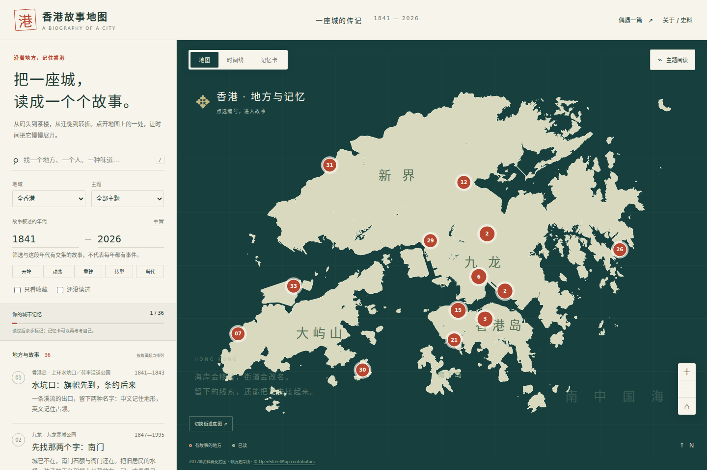
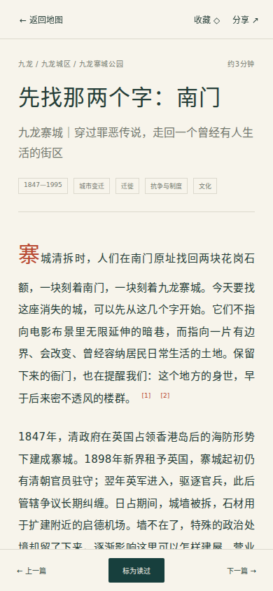

# 香港故事地图 · 一座城的传记

**在线阅读：[打开香港故事地图](https://hongjinrui.github.io/ToKnow_Hongkong/)**

直接分享这个链接，别人就能在浏览器中阅读，无需下载或登录。

**从地图进入香港，从故事记住地方。** 36篇经过选择的近现代故事，跨越1841—2026年的叙事范围，覆盖港岛、九龙、新界与离岛。正文约2.3万字（含标点），180个段落保留出处，114条故事内来源记录对应111个不同链接。

[下载单文件地图](https://github.com/hongjinrui/ToKnow_Hongkong/raw/refs/heads/main/hong-kong-story-atlas.html) · [下载完整项目ZIP](https://github.com/hongjinrui/ToKnow_Hongkong/archive/refs/heads/main.zip) · [纯文字故事目录](#故事目录) · [验证记录](docs/VERIFICATION.md)

查看手机阅读界面

## 打开就能读

- **在线阅读**：打开 [香港故事地图](https://hongjinrui.github.io/ToKnow_Hongkong/)，可直接分享网址或某一篇故事的链接。
- **离线保存**：下载上面的单文件HTML，保存后用Chrome、Edge、Firefox或Safari打开。故事、地理轮廓、筛选、时间线、记忆卡均已装进一个文件。
- **完整版本**：下载ZIP并解压，双击根目录 `index.html`。保留 `data/`、`app.js`、`core.js` 与 `styles.css` 的相对位置。不需要API密钥、账号或构建步骤。
- `reader.html` 是不依赖JavaScript的完整阅读版；`memory-cards.html` 可打印或保存为PDF。
- 在线版由GitHub Pages托管；离线版与源代码仍可下载保存。

首屏就是地点地图。点击聚合编号可逐篇选择；左侧列表始终保留全部可读入口。按年代、地域、主题和关键词组合筛选，或从6条阅读线索进入。读完手动标记，收藏再访，利用记忆卡复述地点的转折。记录只保存在本机浏览器；无法保存时仍能继续阅读。

街道地图是可选联网层，点击后才加载Leaflet/OpenStreetMap。默认离线底图使用2017资料概化轮廓，并非历史岸线；旧址、现址、纪念点与范围定位在每篇另注。阅读路线不等于步行导航。

## 不是景点名录

故事从实际读过的文献出发，用人物、物件、处境与转折组织。开埠、医院、革命、战争、工厂、公屋、迁村、交通、食物、疫症、保育和政治变化放在同一张图上。每篇包含：

- 5段原创叙事及逐段出处；
- 关键年代、相关人物与一句记忆锚点；
- 今日遗存、近似坐标及旧址关系；
- 来源支持范围与仍未消除的分歧。

不编造对白、人物心理或现场感官。官方记述、研究、新闻、商号自述与居民口述分别归属；不把一种立场写成全体人的感受。36篇是理解城市的入口，不代表香港历史已被穷尽。

## 先用已有成果

已检索并实际审读 [Urban Senses of Hong Kong](https://daisywuh.github.io/Urban-Senses-of-Hong-Kong/)、[Kai Tak Memory](https://github.com/Peippa/kaitak-memory)、[Hong Kong Streets Timeline](https://cswbrian.github.io/street-naming-map/)、[香港纪事馆](https://hongkongstory.org/)、[StoryMapJS](https://github.com/NUKnightLab/StoryMapJS)等。它们分别提供文化记忆、地方历史、街道年代和史料索引。地图“关于”保留直接入口。

本项目补上有出处的中文地方叙事与自由地图探索层，没有复制他人的长文、歌词或课堂媒体。[检索结果与复用决定](docs/RESEARCH.md)记录范围和许可边界。

写作前实际阅读了[Writing Principles](https://github.com/haowjy/creative-writing-skills/blob/main/skills/writing-principles/SKILL.md)和[Scene Construction](https://github.com/haowjy/creative-writing-skills/blob/main/skills/creative-writing-craft/resources/scene-construction.md)等叙事技能；借鉴具体处境开场、节奏与清楚转场，并加上历史叙事的证据约束。见[写作与考证规范](docs/EDITORIAL.md)。

## 故事目录

| 地点 | 故事 | 叙事跨度 |
| --- | --- | --- |
| 上环水坑口／荷李活道公园 | [水坑口：旗帜先到，条约后来](stories/possession-point-1841.md) | 1841–1843 |
| 九龙寨城公园 | [先找那两个字：南门](stories/kowloon-walled-city.md) | 1847–1995 |
| 文武庙 | [香火钱，走进了病房和课室](stories/man-mo-tung-wah.md) | 1847–1931 |
| 尖沙咀天星码头 | [星期一，渡船要添煤](stories/star-ferry.md) | 1880–2006 |
| 杨耀记旧址 | [课室之外，店铺里谈起了另一种中国](stories/yang-yao-kee-sun.md) | 1887–1912 |
| 卜公花园 | [一座花园，是怎样腾出来的](stories/blake-garden-plague.md) | 1894–1996 |
| 大澳棚屋区 | [烧过以后，还能不能在这里住](stories/tai-o.md) | 1900–2019 |
| 西港城电车总站 | [铁轨铺好以后，街道还要重新学习](stories/tram-western-market.md) | 1904–2025 |
| 牛棚艺术村及艺术公园 | [铁环还在，牛群已走](stories/cattle-depot.md) | 1908–2019 |
| 香港大学本部大楼 | [大楼落成时，捐建它的人已经不在](stories/hku-main-building.md) | 1910–1956 |
| 前九广铁路钟楼 | [火车走后，钟楼留下](stories/railway-clock-tower.md) | 1910–2010 |
| 香港铁路博物馆／旧大埔墟火车站 | [一张车票，把墟市接到世界](stories/tai-po-railway.md) | 1910–2004 |
| 马场先难友纪念碑 | [看台倒塌以后，名字留在了山上](stories/racecourse-fire-memorial.md) | 1918–2015 |
| 蓝屋建筑群 | [修好一栋楼，能不能也留下邻居](stories/blue-house-tenants.md) | 1920–2017 |
| 上环海旁／中山纪念公园纪念点 | [上环海旁：把船停下的人](stories/seamen-strike-1922.md) | 1921–2024 |
| 启德旧机场 | [跑道熄灯的那一夜](stories/kai-tak-airport.md) | 1925–1998 |
| 中环威灵顿街莲香楼旧址 | [蒸笼推走以后，茶楼还在哪里](stories/lin-heung.md) | 1926–2026 |
| 油麻地戏院 | [银幕退场，锣鼓登台](stories/yau-ma-tei-theatre.md) | 1930–2012 |
| 皇都戏院旧址 | [屋顶上的弧线，装过一座小上海](stories/north-point-state-theatre.md) | 1937–1997 |
| 黄泥涌峡军事遗址径 | [黄泥涌峡：一个指挥所，和没有结束的战争](stories/wong-nai-chung-1941.md) | 1941–1945 |
| 香港仔避风塘 | [一碗面，从船上送来](stories/aberdeen-boat-kitchen.md) | 1950–2026 |
| 中环结志街兰芳园老档 | [一只布袋，把西茶变成香港奶茶](stories/lan-fong-yuen.md) | 1952–2017 |
| 骏业街InPARK | [塑胶花搬走以后](stories/kwun-tong-inpark.md) | 1953–2019 |
| 美荷楼 | [走廊里的一顿饭](stories/mei-ho-house.md) | 1953–2008 |
| 沥源邨 | [从补屋顶，到搬进楼上的家](stories/lek-yuen.md) | 1960–2015 |
| 万宜水库 | [一座城市的水，另一条村的故乡](stories/high-island-reservoir.md) | 1963–1979 |
| 新蒲岗六合街／大有街一带 | [新蒲岗：一朵塑胶花之后](stories/san-po-kong-1967.md) | 1967–1967 |
| 九龙城城南道及衙前围道一带 | [星期日，城南道多了一种回家的路](stories/kowloon-city-thai.md) | 1970–2025 |
| 三栋屋博物馆 | [屋留下了，村搬走了](stories/sam-tung-uk.md) | 1970–2020 |
| 长洲北帝庙游乐场 | [重新爬上包山的人](stories/cheung-chau-buns.md) | 1978–2026 |
| 流浮山 | [一只蚝，等过四五个夏天](stories/lau-fau-shan.md) | 1980–2026 |
| 湾仔香港会议展览中心新翼 | [零时，旗帜在会展换过](stories/hkcec-handover.md) | 1984–1997 |
| 赤鱲角／香港国际机场 | [把一座机场搬过一个夜晚](stories/chek-lap-kok.md) | 1990–1999 |
| 沙田威尔斯亲王医院 | [十一人同时请了病假](stories/prince-of-wales-sars.md) | 2003–2003 |
| 金钟夏悫道 | [夏悫道上举起的伞](stories/admiralty-umbrellas.md) | 2014–2014 |
| 金钟立法会综合大楼 | [从一份修例草案，到另一套政治日常](stories/legco-2019-2024.md) | 2019–2024 |

## 网站发布

访问地址：**https://hongjinrui.github.io/ToKnow_Hongkong/**

`main` 是内容和程序的维护分支。每次更新会通过 `Publish GitHub Pages` 工作流检查资料，再同步到 `gh-pages` 发布分支并请求重新部署。工作流会等待发布完成，检查首页、脚本、故事数据及阅读页面的在线内容与当前提交一致。可在 [Actions](https://github.com/hongjinrui/ToKnow_Hongkong/actions/workflows/pages.yml) 查看发布结果或手动重跑。

分享具体故事时，在地图里打开故事，使用“分享”按钮复制带 `#story=…` 的链接。

## 资料和维护

- [完整文献目录](docs/SOURCES.md) · [资料检索与限制](docs/RESEARCH.md) · [写作规范](docs/EDITORIAL.md) · [署名与许可](docs/ATTRIBUTION.md)。
- `data/stories.json` 是可编辑、可复核的结构化正文；`data/stories.js` 为直接打开网页使用的同一数据副本。
- 地理轮廓另存于 `data/coast.js`，保留上游出处及ODbL边界；不冒称复原各年代填海。
- 原创程序MIT，原创叙事/文档CC BY4.0；第三方原文、地图瓦片与数据按各自许可。
- 资料查阅日期2026-11-03；来源可能改版，后续纠错可直接提交Issue或修改故事与数据。

需要开发环境时使用Node22：`npm test` 验证内容与筛选；`npm install` 后运行 `npx playwright install chromium`、`npm run test:browser`；`npm run package` 生成单文件到 `artifacts/`。GitHub Actions同时测试桌面、手机、离线与存储被禁用的情况，并保存截图与打包文件。
